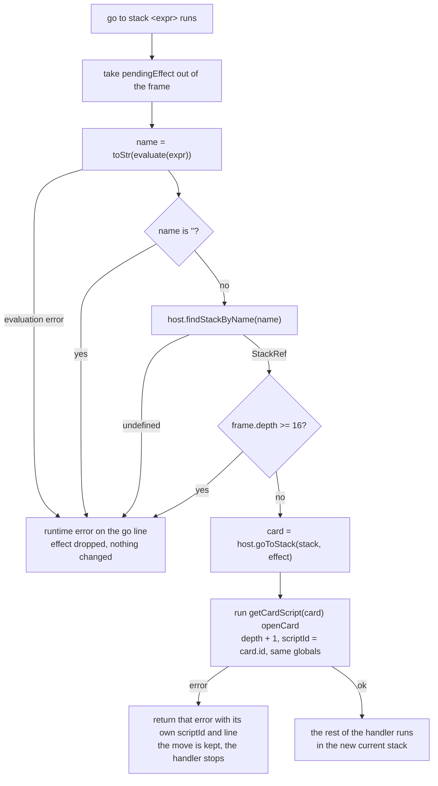

# Design Document: go to stack

## Overview

This feature adds `go [to] stack <expression>` to the HyperTalk interpreter. It is a third kind of `go` target next to the named card targets and `card <expression>`. The parser, the printer and the runtime treat it like `go to card <expression>` wherever they can, and the code shares the existing paths: the primary-expression rule, the parentheses hint, the pending visual effect, the depth limit, and the nested `openCard` run with its error reporting.

The changes stay inside `src/hypertalk` and `test/hypertalk`. Requirement numbers below ("Requirement 3.2") refer to this spec's requirements.md. R-numbers and P1 to P6 refer to the interpreter spec in `.kiro/specs/hypertalk-interpreter/`.

Summary of the changes:

| File | Change |
|---|---|
| `src/hypertalk/tokens.ts` | `'stack'` added to `KEYWORDS`, so it is reserved (R8.4) |
| `src/hypertalk/ast.ts` | `GoTarget` gains `{ k: 'stack'; expr: Expr }` |
| `src/hypertalk/parser.ts` | `go()` accepts `stack <primary>`, with its own parentheses hint; the fallback message lists `stack …` |
| `src/hypertalk/printer.ts` | prints `go to stack <primary>` |
| `src/hypertalk/host.ts` | `StackRef`, `findStackByName`, `goToStack`; documentation of the current-stack rule and of card ids |
| `src/hypertalk/runtime.ts` | `go()` gets a stack branch; the depth check and the `openCard` run move into two helpers that both branches call |
| `src/hypertalk/index.ts` | exports the `StackRef` type |
| `test/hypertalk/helpers/fakeHost.ts` | holds stacks; `state` stays the current stack's `{ cards, current }` |
| `test/hypertalk/helpers/arbitraries.ts` | stack targets for P1 and P4, generators for the stack P2, a stack session generator for P3 and P5 |
| tests | new example tests and the stack P2; P3 and P5 extended; three copies of the go fallback message updated |

## Architecture

The pipeline stays `source → tokens → AST → run`. No new module is added. The runtime still holds no card or stack state: it asks the host at the moment each statement runs (R10.1, Requirement 6.8).



The card branch of `go` keeps its order (resolve the target, check the depth, move, open), so both branches report a missing target before the depth limit, as the requirements decided.

## Components and Interfaces

### tokens.ts

`'stack'` joins the `go` line of `KEYWORDS`:

```ts
'go', 'to', 'next', 'prev', 'first', 'last', 'card', 'stack',
```

`RESERVED` and `isReserved` derive from `KEYWORDS`, so `put 1 into stack` and `global stack` become reserved-word errors with no further change (Requirement 1.9, 1.10). The same rule makes `stack` an error where a value is expected, for example `put stack into x` or `go to card stack`. Those were valid before this change (a variable named `stack`). No script in the repository uses `stack` as a variable name. The `nameArb` generator filters reserved words through `isReserved`, so generated variable names stay valid without an edit.

### ast.ts

```ts
export type GoTarget =
  | { k: NavTarget }
  | { k: 'card'; expr: Expr }
  /** A stack name. Never a number: `go to stack 3` looks for the stack named "3". */
  | { k: 'stack'; expr: Expr };
```

`stripPositions` and `WithoutPos` need no change. `go stack e` and `go to stack e` give the same node, because the node does not keep `to` (Requirement 1.2).

### parser.ts

`go()` handles `card` and `stack` the same way. Only the hint differs:

```ts
/** What to write instead of a calculation after the target of `go to card` or `go to stack`. */
const PAREN_HINTS = {
  card: 'put a calculated card number in parentheses, for example go to card (n + 1)',
  stack: 'put a calculated stack name in parentheses, for example go to stack ("Haunted" && "House")',
} as const;

// go [to] next|prev|first|last card | go [to] card <primary> | go [to] stack <primary>
// (R2.1, go-to-stack-command Requirement 1)
private go(): Stmt {
  const go = this.advance();
  if (this.atWord('to')) this.advance();
  const t = this.current();
  const word = t.kind === 'word' ? t.text.toLowerCase() : '';
  if (NAV_TARGETS.has(word)) {
    this.advance();
    this.expectWord('card', `expected "card" after "${t.text}"`);
    return { t: 'go', target: { k: word as NavTarget }, pos: pos(go) };
  }
  if (word === 'card' || word === 'stack') {
    this.advance();
    const expr = this.primary();
    const after = this.current();
    if (after.kind === 'op' && CALCULATION_OPS.has(after.text)) this.fail(after, PAREN_HINTS[word]);
    return { t: 'go', target: { k: word, expr }, pos: pos(go) };
  }
  this.fail(t, 'expected next card, prev card, first card, last card, card … or stack … after "go"');
}
```

How each syntax error of Requirement 1 comes about:

- A calculation operator after the target (Requirement 1.4): the check above, at the operator.
- No target (Requirement 1.5): `primary()` meets the line break or the end of the script and reports `expected a value after "stack"`. Both tokens sit on the `go` line.
- A token that cannot continue the statement (Requirement 1.6): `primary()` stops, and `block()`'s `expectLineEnd('the command')` reports `unexpected … after the command`. In a one-line `if`, an `else` after the target is still read as the `else` of that `if`.
- `go to card 1 of stack "A"` (Requirement 1.8): `of` is not an operator, so the same `expectLineEnd` reports `unexpected "of" after the command`. The parser needs no special case.
- An unknown target word (Requirement 1.7): the new fallback message.

A stack `go` is an ordinary statement, so it works in both `if` forms and in `else if` chains with no other change (Requirement 1.3).

### printer.ts

```ts
case 'go':
  switch (s.target.k) {
    case 'card':
    case 'stack':
      // The target is a primary expression: anything else is printed in parentheses (Requirement 2.2).
      return `go to ${s.target.k} ${printExpr(s.target.expr, PRIMARY)}`;
    default:
      return `go to ${s.target.k} card`;
  }
```

`printExpr(e, PRIMARY)` already adds parentheses when the expression's level is below `PRIMARY`, which is what the card target uses. So `{ t: 'bin', op: '&&', … }` prints as `go to stack ("Haunted" && "House")`.

### host.ts

```ts
/** A card as the host reports it. */
export interface CardRef {
  /** 1-based position in the current stack. */
  index: number;
  /** Unique across all stacks, so it names the card's script on its own (R12.5). */
  id: string;
  name: string | null;
}

/** A stack as the host reports it. */
export interface StackRef {
  id: string;
  name: string;
}

/**
 * Asynchronous only where a person or a timer is involved (dialogs, wait, haunts).
 * Every name lookup is case-insensitive (R1.8) and, for fields and buttons, happens on
 * the card that is current at the moment of the call (R2.6).
 *
 * The host holds one or more stacks. cardCount, currentCard, findCardByName, cardAt, goToCard
 * and getCardScript refer to the current stack: the one that holds the current card. Card ids
 * are unique across all stacks.
 */
export interface Host {
  cardCount(): number;
  currentCard(): CardRef;
  findCardByName(name: string): CardRef | undefined;
  /** undefined outside 1..cardCount. */
  cardAt(index: number): CardRef | undefined;
  /** Makes `card` the current card and plays `effect` with the change (R3.2). */
  goToCard(card: CardRef, effect?: Effect): void;

  /** Case-insensitive; undefined when no stack has this name. */
  findStackByName(name: string): StackRef | undefined;
  /** Makes `stack` the current stack, shows its first card with `effect`, and returns that card. */
  goToStack(stack: StackRef, effect?: Effect): CardRef;

  // getField, setField, setVisible, answer, ask, wait, haunt, getCardScript: unchanged.
}
```

`RunContext` and `RunResult` do not change. The two new methods are synchronous, like the other navigation calls, so state changes stay easy to follow.

### runtime.ts

`go()` splits on the target kind. The depth check and the nested `openCard` run become two helpers, so both kinds share one implementation of R14.2 to R14.4 and R12.5:

```ts
type GoStmt = Extract<Stmt, { t: 'go' }>;
/** The targets that name a card of the current stack. */
type CardTarget = Exclude<GoTarget, { k: 'stack' }>;

/**
 * Moves to the target with the pending effect, then runs the new card's openCard (R2, R3, R14).
 * A target that does not exist is an error on the go line before anything changes, and it is
 * reported before the depth limit (R2.4, Requirement 3.6, 3.8). An error in the openCard ends
 * this run too, and the move is kept (R12.3, R12.5).
 */
async function go(stmt: GoStmt, frame: Frame, ctx: RunContext): Promise<void> {
  // The effect belongs to this go: played when it moves, dropped when it fails (R3.2, R3.3).
  const effect = frame.pendingEffect;
  frame.pendingEffect = undefined;
  const { target } = stmt;
  let card: CardRef;
  if (target.k === 'stack') {
    const stack = targetStack(target.expr, stmt.pos, frame, ctx);
    checkDepth(stmt.pos, frame);
    // Also when `stack` is the current stack: it opens at its first card (Requirement 4.2).
    card = ctx.host.goToStack(stack, effect);
  } else {
    card = targetCard(target, stmt.pos, frame, ctx);
    checkDepth(stmt.pos, frame);
    ctx.host.goToCard(card, effect);
  }
  await openCard(card, frame, ctx);
}

/**
 * The stack a `go to stack` names. The value is always a name, also when it is a number
 * (Requirement 3.2). The name goes to the host as it is, case and spaces kept (Requirement 3.3).
 */
function targetStack(expr: Expr, at: Pos, frame: Frame, ctx: RunContext): StackRef {
  const name = toStr(evaluate(expr, frame, ctx));
  if (name === '') fail(at, 'expected a stack name, but got an empty value');
  const stack = ctx.host.findStackByName(name);
  if (!stack) fail(at, `there is no stack named ${quoteValue(name)}`);
  return stack;
}

/** A go at depth 16 would start a 17th openCard, whichever kind of go it is (R14.4, Requirement 4.5, 4.6). */
function checkDepth(at: Pos, frame: Frame): void {
  if (frame.depth >= MAX_OPEN_CARD_DEPTH) {
    fail(at, `cannot go on: openCard handlers can chain at most ${MAX_OPEN_CARD_DEPTH} levels deep`);
  }
}

/**
 * Runs the openCard of the card a go just showed. Going to the current card or the current
 * stack still opens it (R2.5, Requirement 4.2). Fresh locals, the same globals (R14.2, Requirement 5.4).
 */
async function openCard(card: CardRef, frame: Frame, ctx: RunContext): Promise<void> {
  const opened = await run(
    ctx.host.getCardScript(card),
    'openCard',
    { host: ctx.host, globals: ctx.globals, scriptId: card.id },
    frame.depth + 1,
  );
  // The innermost card that failed names itself; outer levels pass its error on unchanged.
  if (!opened.ok) {
    throw new OpenCardAbort({ ...opened.error, scriptId: opened.error.scriptId ?? card.id }, opened.lines);
  }
}
```

`targetCard` keeps its body. Its parameter type narrows from `GoTarget` to `CardTarget`, so its `switch` stays exhaustive.

How the runtime meets the requirements:

- Requirement 3.1, 3.2: `toStr` turns a number into its `String(n)` text. No path calls `toNumber` or `cardAt` for a stack target.
- Requirement 3.7: the effect leaves the frame before the target is evaluated. Every failure before `goToStack` (evaluation error, empty name, missing stack, depth) throws, so `goToStack` and `goToCard` never see the effect.
- Requirement 4.1: `goToStack` is called once, with the `StackRef` the host returned and the effect.
- Requirement 4.4, 4.7, 4.8, 4.9: `openCard` is the code that already runs after `go to card`, moved into a helper. `card.id` is the first card's id. A deeper error keeps the `scriptId` of the card that raised it.
- Requirement 4.6: `frame.depth` counts every nested `openCard` run, so the chain limit is the same for both kinds of `go` and for chains that mix them.
- Requirement 5.1 to 5.3: the runtime caches nothing. After `goToStack`, `cardCount`, `currentCard`, `findCardByName`, `cardAt`, `getField`, `setField` and `setVisible` answer from the new current stack, because the host says so (Requirement 6.5).
- A host that throws in `findStackByName` or `goToStack` gives a runtime error on the `go` line through the existing top-level catch in `run`, as for every other host call.
- The runtime uses the `CardRef` that `goToStack` returns as it is. It does not check that `index` is 1: that is the host's contract (Requirement 4.3), and the fake host is tested for it.

### index.ts

```ts
export type { CardRef, Host, RunContext, RunResult, StackRef } from './host';
```

`StackRef` is a type, so `Object.keys(api)` stays `['parse', 'print', 'runHandler']`.

## Data Models

### AST

The only new node shape is the `stack` variant of `GoTarget`. A stack `go` is `{ t: 'go', target: { k: 'stack', expr }, pos }`, where `pos` is the `go` token, as for every `go`.

### StackRef

`{ id: string; name: string }`. The host decides both. The runtime only passes a `StackRef` from `findStackByName` to `goToStack` and never builds one itself.

### Fake host

```ts
/** One stack's cards and its current card. `FakeHost.state` is the current stack's. */
export interface FakeStack {
  cards: FakeCard[];
  /** 1-based index of the current card. 1 in every stack that is not the current stack. */
  current: number;
}

/** One stack of the fake host. */
export interface FakeStackEntry {
  id: string;
  name: string;
  state: FakeStack;
}

/** The single-stack form, unchanged (Requirement 7.2). */
export interface FakeHostInit {
  cards: FakeCardInit[];
  /** 1-based; defaults to 1. */
  current?: number;
  replies?: Reply[];
}

export interface FakeStackInit {
  /** Defaults to `stack-<n>`, where n is the 1-based position in `stacks`. */
  id?: string;
  name: string;
  /** At least one. A card without an id gets `<stack id>/card-<n>`, n its position in this stack. */
  cards: FakeCardInit[];
}

/** The form with several stacks (Requirement 7.3). */
export interface FakeStacksInit {
  stacks: FakeStackInit[];
  /** 1-based position in `stacks` of the starting stack; defaults to 1. */
  currentStack?: number;
  /** 1-based index of the starting card in that stack; defaults to 1. */
  current?: number;
  replies?: Reply[];
}

export type HostCall =
  | /* … the existing entries … */
  | { call: 'findStackByName'; name: string }
  | { call: 'goToStack'; id: string; effect?: Effect };

/** The stack a host built from `cards` alone holds (Requirement 7.2). */
export const DEFAULT_STACK: StackRef = { id: 'stack-1', name: 'Stack 1' };
```

`FakeHostInit` keeps its name and shape, so `Partial<FakeHostInit>` and `new FakeHost({ cards, ...init })` in the existing tests still type-check. The constructor takes `FakeHostInit | FakeStacksInit` and tells them apart with `'stacks' in init`.

## Fake host design

### The constraint

Requirement 7.2 says the existing tests that build a `FakeHost` from `cards` must pass without edits. `fakeHost.test.ts` compares `host.state` with exactly `{ cards: [...], current: 1 }`, and about 30 lines in other tests read `host.state.current` and `host.state.cards` as "the current card" and "the cards". Requirement 9.8 asks P3 to compare all stacks.

### Alternatives

| Approach | Existing tests | P3, clone | Verdict |
|---|---|---|---|
| A. `state` stays the current stack's `{ cards, current }`. All stacks, the current one included, live in a new `stacks` list. `state` becomes a getter onto the current entry's `state` object. | Pass unchanged. Every reader of `state.cards` and `state.current` keeps meaning "the current stack", which is the rule the Host now states (Requirement 6.5). | P3 adds `stacks` and `stack()` to what it compares. `clone()` rebuilds through the stacks form. | Chosen |
| B. `state` widens to `{ stacks, currentStack, current }`. | The exact `toEqual` in `fakeHost.test.ts` fails, and every `state.cards` reader breaks. Violates Requirement 7.2 and 9.12. | Simple | Rejected |
| C. `state` stays a plain field for the current stack, and the other stacks sit in `otherStacks`. `goToStack` swaps the two. | Pass unchanged. | The order of `otherStacks` depends on the history of moves, the current stack's id and name need a third place to live, and `clone` must rebuild the order. | Rejected: more moving parts than A for the same result |

### How approach A works

```ts
export class FakeHost implements Host {
  /** Every stack, in the order given. The current one is stacks[currentStackIndex]. */
  readonly stacks: FakeStackEntry[];
  private currentStackIndex: number;
  replies: Reply[];
  readonly log: HostCall[] = [];

  /** The current stack's cards and current card: the same object as its entry's `state`. */
  get state(): FakeStack {
    return this.stacks[this.currentStackIndex]!.state;
  }
}
```

- **Invariant.** Only the current stack has a current card of its own. Every other stack has `state.current === 1`, the card that `goToStack` opens. The constructor sets it, and `goToStack` sets the stack it leaves to 1 before it switches, then sets the target's `current` to 1. A stack that is left does not remember its card. That memory would have no effect, because the next `goToStack` opens card 1 anyway, and it would make clone and P3 depend on history that changes nothing.
- **Constructor.** The cards form becomes a one-stack init `{ stacks: [{ id: 'stack-1', name: 'Stack 1', cards }], current, replies }` whose cards get the default ids `card-<n>` they always had. Then one path builds and checks every stack. It throws when there is no stack, a stack has no cards, two stacks share an id, two stack names are equal ignoring case, two cards in any stacks share an id, `currentStack` is not an integer in 1..stacks.length, or `current` is not an integer in 1..that stack's card count (Requirement 7.5). The existing throws for the cards form (no cards, duplicate ids, current out of range) come out of the same checks.
- **Card calls.** `cardCount`, `currentCard`, `findCardByName`, `cardAt`, `goToCard` and `getCardScript` keep their code, which reads `this.state`. They now answer from the current stack (Requirement 7.6). `getField`, `setField` and `setVisible` go through `card()`, which is the current card of the current stack.
- **`cardOf(ref)`** keeps its code: the card at `ref.index` in the current stack must have `ref.id`. A ref from another stack, such as a ref kept from before a `goToStack`, has an id that no card of the current stack has, because ids are unique across stacks. So it throws (Requirement 7.10).
- **`findStackByName(name)`** logs `{ call: 'findStackByName', name }` and returns `{ id, name }` of the entry whose name equals `name` ignoring case, with the name as stored, or `undefined` (Requirement 7.7).
- **`goToStack(stack, effect)`** logs `{ call: 'goToStack', id: stack.id, ...(effect ? { effect } : {}) }`, as `goToCard` logs before it checks its ref. Then it finds the entry with that id. When there is none, or its name is not exactly `stack.name`, it throws before changing anything (Requirement 7.9). Otherwise it applies the invariant, switches `currentStackIndex`, and returns `{ index: 1, id, name }` of the first card (Requirement 7.8).
- **`stack(): StackRef`** returns `{ id, name }` of the current stack. It is a read for tests next to `card()`, `fieldText()` and `isVisible()`, so it is not logged (Requirement 7.12).
- **`clone()`** builds a copy through the stacks form: every entry's id, name and `structuredClone` of its cards, `currentStack: currentStackIndex + 1`, `current: this.state.current`, the remaining replies, then the log so far. Because of the invariant, these values describe the whole state, so the copy equals the original (Requirement 7.11). A FakeCard is a valid FakeCardInit, as the current `clone` already relies on.
- **P3** compares `host.state`, `host.stacks` and `host.stack()` between the two runs, plus the results, replies, logs and globals as before (Requirement 9.8). Before running, it also checks that the clone's `stacks` and `stack()` equal the original's.
- **P5's `scriptOf`** looks for the error's `scriptId` in every stack: `host.stacks.flatMap((s) => s.state.cards).find((c) => c.id === error.scriptId)` (Requirement 9.9). Card ids are unique across stacks, so the match is the card that raised the error.

## Error Handling

All errors keep the existing shapes (`SyntaxError`, `RuntimeError`), carry the line of the `go` statement, or the line inside the card script that failed, and never throw out of `parse` or `runHandler`.

### Syntax errors

Line 1 is `on mouseUp`, and each command is indented by two spaces.

| Line 2 | Line, column | Message |
|---|---|---|
| `go to stack "A" & "B"` | 2, 19 | `put a calculated stack name in parentheses, for example go to stack ("Haunted" && "House")` |
| `go to stack` | 2, 14 | `expected a value after "stack"` |
| `go to stack "A" "B"` | 2, 19 | `unexpected "B" after the command` |
| `go to card 1 of stack "A"` | 2, 16 | `unexpected "of" after the command` |
| `go home` | 2, 6 | `expected next card, prev card, first card, last card, card … or stack … after "go"` |
| `put 1 into stack` | 2, 14 | `"stack" is a reserved word and cannot be a variable name` |
| `global stack` | 2, 10 | `"stack" is a reserved word and cannot be a variable name` |

Only the `go home` message is new text for an existing error. It is spelled out in `test/hypertalk/parser.test.ts` (`GO_MESSAGE`), `test/hypertalk/runtime.navigation.test.ts` (the R14.3 syntax error test) and `test/hypertalk/helpers/lexMask.ts` (`GO_MESSAGE`). Those three strings change and nothing else in those tests (Requirement 9.12). The bugfix specs under `.kiro/specs/lexer-error-masks-parse-error-fix/` quote the old message as history and stay as they are (Requirement 10.8).

### Runtime errors

| Script | Message |
|---|---|
| `go to stack ""`, or `ask` cancelled then `go to stack it` | `expected a stack name, but got an empty value` |
| `go to stack "Cellar"` with no such stack | `there is no stack named "Cellar"` |
| `go to stack 2` with no stack named "2" | `there is no stack named "2"` |
| `go to stack (1 / 0)` | `cannot divide by zero` (the existing message) |
| a `go to stack` in an `openCard` at depth 16 | `cannot go on: openCard handlers can chain at most 16 levels deep` (the existing message) |

The name in the "no stack" message goes through `quoteValue`, as card names do, so it is quoted and cut after 40 characters with `…`. Each of these errors is on the line of the `go`, stops the handler, leaves the current stack and card unchanged, and drops the pending effect.

An error in the `openCard` of the first card, or deeper, is returned as it is now for `go to card`: with the `scriptId` of the card that raised it and a line in that card's script. The move to the new stack is kept.

## Correctness Properties

*A property is a characteristic or behavior that should hold true across all valid executions of a system: a formal statement about what the system should do. Properties are the bridge between human-readable specifications and machine-verifiable correctness guarantees.*

Each property extends or adds to a property of the interpreter spec. The test name starts with that spec's property name, as the existing tests do, and a comment above it carries the tag `Feature: go-to-stack-command, Property <n>: <title>`.

### Property 1: Round trip with stack targets (P1)

*For any* generated script tree, including `go` statements with a `stack` target whose expression is of any form (string, number, `true`/`false`, variable, `it`, field, operator, `not`, parentheses), at any `if` depth and in both `if` forms, `print(parse(print(tree)))` equals `print(tree)`; and *for any* seed, the source that `renderScript` writes for the tree (random keyword case and spacing, `to` present or absent) parses to the same tree, ignoring positions, as the canonical print.

**Validates: Requirements 1.1, 1.2, 1.3, 2.1, 2.2, 2.3, 9.1**

### Property 2: Stack navigation outcomes (P2 stack navigation)

*For any* 1 to 5 stacks with names unique ignoring case, each with 1 to 4 cards whose ids are unique across all stacks and whose first card's script is empty, valid, has a runtime error in `openCard`, or has a syntax error; *for any* starting stack and card in it; *for any* optional `visual effect`; and *for any* target text that is a stack name as written, a stack name in other case, or no stack's name (the empty string included), passed as a string literal, as the reply to `ask` through `it`, or as a number literal whose `String(n)` is that text, running the `mouseUp` handler with the one `go to stack` gives exactly one of these outcomes:

- (a) no error, the current stack is the stack whose name matches the text ignoring case, and the current card is its first card;
- (b) a runtime error with no `scriptId` on the line of the `go`, the current stack and card equal the starting ones, and the log has no `goToStack` and no `goToCard` call;
- (c) an error with the first card's id as `scriptId`, a line in 1..lineCount of that card's script, and the kind and line the generator gave that script, while the current stack is the matching stack and the current card is its first card.

The outcome is the one a model of the generated stacks expects: (b) when the text is empty or no stack name matches it ignoring case, (c) when one matches and its first card's script has an error, and (a) otherwise. In every case the log holds exactly one `findStackByName` call, with the text exactly as the model computed it, or none when the text is empty. It also holds exactly one `goToStack` call, with the matching stack's id and the generated effect (no `effect` key when there was none), when a stack matches, and none otherwise.

**Validates: Requirements 3.1, 3.2, 3.3, 3.4, 3.5, 3.6, 3.7, 3.8, 4.1, 4.2, 4.3, 4.4, 4.7, 4.9, 9.2, 9.3, 9.4, 9.5**

### Property 3: Determinism across stacks (P3)

*For any* session, either a single-stack session as today or a session of 1 to 3 stacks whose card names are unique across the session and whose `mouseUp` script mixes `go to stack` (existing names in random case, missing names, the empty name, `it`) with every other command, running the script twice from a fake host and its clone, with the same replies and globals, gives equal results, equal `state`, equal `stacks` (every stack's cards and current card), equal current stack, equal remaining replies, equal globals, and equal call logs including the `findStackByName` and `goToStack` calls.

**Validates: Requirements 6.8, 7.11, 9.7, 9.8**

### Property 4: Syntax error lines with the stack keyword (P4)

*For any* rendered valid script, now including `go to stack` statements, with one to three mutations drawn from a set that includes the token `stack` as a replacement and stack junk lines such as `go to stack`, `go to stack n + 1`, `go to card 1 of stack "A"` and `put 1 into stack`, whenever `parseUnguarded` fails, the error's line is an integer in 1..lineCount of the source and its column is an integer of at least 1; and `parse` returns the same result as `parseUnguarded`.

**Validates: Requirements 1.4, 1.5, 1.6, 1.8, 1.10, 9.10**

### Property 5: Runtime error lines across stacks (P5)

*For any* session from the same two generators as Property 3, whenever `runHandlerUnguarded` returns an error, the script that raised it is the run script when the error has no `scriptId`, and otherwise the card script with that id, found in any stack of the session. The error's line is an integer in 1..lineCount of that script, and the line holds code, not a blank or comment-only line. `runHandler` and `runHandlerUnguarded` return equal results from a host and its clone.

**Validates: Requirements 4.7, 4.8, 9.7, 9.9**

### Why these five

- Requirement 1.1 to 1.3 and 2.1 to 2.3 are all consequences of one round trip over generated trees, so they share Property 1 instead of one property each.
- The checks of Requirement 3 (lookup) and Requirement 4 (opening) run on the same generated case, and the log clause only means something next to the outcome. So they form one Property 2, which is also the single test Requirement 9.2 asks for.
- Requirement 3.5 (empty name) is an edge case inside Property 2's missing-name generator. It is not a property of its own.
- Requirement 4.5, 4.6 and 4.8 (depth limit, mixed chains, innermost id) are fixed chains. They stay example tests. Property 5 checks the line range of whatever deeper error the stack sessions reach.
- Requirement 5 (continuing in the new stack) is covered by example tests, as the clarify phase decided: the card P2 stays single-stack (Requirement 9.6), and Property 3 runs card commands after stack gos without a model of where they land.

## Testing Strategy

Tests run with `vitest --run`, and the type check `npm run typecheck` covers the tests too. Property tests use fast-check. Every existing example test stays as written, except the three message strings above (Requirement 9.12).

### Example tests

**`test/hypertalk/parser.test.ts`**, new `describe('go to stack (go-to-stack-command Requirement 1)')` (Requirement 8.1, 8.2):

- `go to stack "Haunted House"`, `go stack "Haunted House"` and `GO To STACK "Haunted House"` give the same `{ t: 'go', target: { k: 'stack', expr: str } }`.
- Each primary kind as target: `"Home"`, `3`, `true`, `it`, `dest`, `field "Where"`, `("Haunted" && "House")`.
- Inside a block `if`, a one-line `if` (`if x then go to stack "A" else go to stack "B"`) and an `else if` chain.
- Every syntax error in the table above, with line, column and full message. For the parentheses hint, one case per operator `+ - * / & &&`, and the message starts with `put a calculated stack name in parentheses` and contains `go to stack (`.
- `go to stack` as the last line of a script with no `end mouseUp` reports the missing target on the `go` line.
- `put 1 into STACK` and `global a, stack` are reserved-word errors on their line.

**`test/hypertalk/lexer.test.ts`**, a new `it` next to the R8.4 tests: `isReserved` is true for `stack`, `STACK` and `Stack` (Requirement 1.9).

**`test/hypertalk/printer.test.ts`**, new `describe('printing go to stack')` (Requirement 8.3): a string target prints as `go to stack "Haunted House"`, a variable as `go to stack dest`, a `bin` target with no `paren` node as `go to stack ("Haunted" && "House")`, and a `not` target with parentheses. Each printed line parses back to the same node.

**`test/hypertalk/runtime.stacks.test.ts`** (new file; Requirement 8.4 to 8.8). It uses a fixture with a Home stack (`home`, one card `Home` with button `House` and field `note`) and a Haunted House stack (`house`, cards `Hall`, `Crypt`, `Attic`, `Lobby`, each with field `note` and button `door`), plus an `inHandler` helper as in `runtime.navigation.test.ts`.

- Existing stack: from Home, `go to stack "Haunted House"` succeeds, `host.stack()` is `house`, the current card is 1, and the log is exactly `findStackByName "Haunted House"`, `goToStack house`, `getCardScript house/card-1`.
- Other case: `go stack "haunted HOUSE"` lands in the same place, and `findStackByName` receives `haunted HOUSE` unchanged.
- Number target: with a stack named `3`, `go to stack 3` succeeds, and the log has `findStackByName "3"` and no `cardCount` or `cardAt` call. With stacks `Home` and `Haunted House` only, `go to stack 2` fails with `there is no stack named "2"`.
- Missing stack and empty name, as literals and through `ask`, with a reply and with a cancelled `ask`: the error on the `go` line, the stack and card unchanged, no `goToStack`, no `goToCard`, a later `answer "after"` not run, and no `findStackByName` call for the empty name.
- An evaluation error in the target (`go to stack (1 / 0)`) after `visual effect dissolve`: the error on the `go` line, nothing changed, the effect not played.
- Current stack: starting in `house` at card 3, `go to stack "Haunted House"` calls `goToStack`, lands on card 1, and runs card 1's `openCard`.
- Effect: `visual effect iris open` then `go to stack "Haunted House"` logs `{ call: 'goToStack', id: 'house', effect: 'irisOpen' }`, and a later `go to next card` in the same handler logs no effect. `visual effect dissolve` then `go to stack "Cellar"` logs no `goToStack` and no `goToCard`.
- `openCard` of the first card runs with fresh locals: it writes `x & it` into its field and gets `''` while the button's handler had set both.
- A runtime error and a syntax error in the first card's script come back with `scriptId: 'house/card-1'`, that script's line, the move kept, and the rest of the button's handler not run.
- A deeper error: the first card's `openCard` does `go to next card`, and card 2's `openCard` fails. The error carries `house/card-2`.
- Depth limit through stack gos: two stacks whose first cards' `openCard` handlers go to each other's stack. The run stops with the depth message on the `go` line of the card at level 16, with 16 `goToStack` calls in the log. A mixed chain (first card of A goes to stack B; card 1 of B goes to the next card; card 2 of B goes to stack A) stops after 16 moves in total, counting `goToStack` and `goToCard` together.
- Rest of the handler: `go to stack "Haunted House"` then `put "here" into field "note"` writes Hall's field and leaves Home's field alone.
- Globals: a Home button runs `global visits`, `put "1" into visits`, `put "local" into x`, `go to stack "Haunted House"`, and Hall's `openCard` appends `"2"` to `visits` and reads `x` as `''`. The global store ends with `visits = "12"`.
- Current stack only, on a variant of the fixture where Home has two cards, `Home` and `Lobby`, so the house has more cards and a card with the same name. Before the stack go, `go to card 3` fails with `there is no card 3: the stack has 2 cards`, `go to card "Crypt"` fails, `go to last card` and `go to card "lobby"` reach Home's card 2. After the stack go, `go to card "Lobby"` reaches the house's card 4, `go to card 3` reaches Attic, `go to first card` from Attic reaches Hall, `go to last card` reaches Lobby, `go to next card` from Lobby wraps to Hall, `go to prev card` from Hall wraps to Lobby, and `field "note"` and `hide button "door"` act on the house's current card only.

**`test/hypertalk/fakeHost.test.ts`**, new `describe` blocks (Requirement 8.9):

- Building from stacks: default stack ids `stack-<n>` and card ids `<stack id>/card-<n>`, given ids kept, the starting stack and card defaulting to 1, `currentStack` and `current` honoured, and `state` being the same object as the current entry's `state`.
- The cards form holds one stack equal to `DEFAULT_STACK`, and `stacks[0].state` is `host.state`.
- Each constructor error of Requirement 7.5: no stacks, a stack with no cards, duplicate stack ids, names equal ignoring case, a card id used in two stacks, `currentStack` of 0, 3 or 1.5 for two stacks, and `current` beyond the starting stack's card count.
- `findStackByName` ignores case and returns the stored name. It returns `undefined` for a missing name and for `''`, and logs each call.
- `goToStack` returns `{ index: 1, id, name }` of the first card, makes it current, logs the id and the effect (no `effect` key without one), resets the left stack to card 1, and also works for the current stack. It throws for an unknown id and for a known id with another name, and in both cases the stack, the card and `stacks` stay unchanged.
- After `goToStack`, the card calls answer from the new stack, and `goToCard` and `getCardScript` with a ref kept from the old stack throw.
- `stack()` adds nothing to the log.
- `clone()` after a `goToStack` with several stacks: equal `stacks`, `stack()`, `state`, replies and log, and the copy changes independently of the original.

**`test/hypertalk/index.test.ts`**, a new `it` (Requirement 6.1 to 6.4, 6.7): `StackRef` from the public API equals `host.StackRef` and `{ id: string; name: string }`, `Host['findStackByName']` is `(name: string) => StackRef | undefined`, and `Host['goToStack']` is `(stack: StackRef, effect?: Effect) => CardRef`.

### Generators (`test/hypertalk/helpers/arbitraries.ts`)

- **P1.** `simpleStmtArb` gains `exprArb.map((expr): S => ({ t: 'go', target: { k: 'stack', expr } }))`. `Renderer.simple` writes `go [to] stack <expr at PRIMARY>`, with `to` dropped at random and random keyword case, as for `card`. A new coverage `it` in `roundtrip.property.test.ts` checks that a sample of `scriptArb` has stack targets of every expression kind, inside `if` blocks too, and that renderings write the stack go both with and without `to`.
- **P4.** `REPLACEMENTS` gains `'stack'`. `JUNK_LINES` gains `'go to stack'`, `'go to stack n + 1'`, `'go to card 1 of stack "A"'` and `'put 1 into stack'`. Mutants of `scriptArb` renderings now contain stack gos. The existing check that at least 30% of mutants fail to parse keeps running unchanged (Requirement 9.10).
- **Stack P2.** New exports:

  ```ts
  export interface GenStackOfCards {
    id: string;                          // `st<n>`, given explicitly
    name: string;
    cards: (GenCard & { id: string })[]; // 1 to 4; ids `st<n>-c<m>`; scripts from cardScriptArb
  }
  export interface GenStackSet {
    stacks: GenStackOfCards[];           // 1 to 5, names unique ignoring case
    currentStack: number;                // 1-based
    current: number;                     // 1-based, in that stack
  }
  export interface StackTarget {
    rel: 'asWritten' | 'otherCase' | 'missing';
    /** The text the runtime must pass to findStackByName. */
    text: string;
    via: 'literal' | 'ask' | 'number';
  }
  export interface StackNavCase { set: GenStackSet; target: StackTarget; effect: Effect | null }
  export const stackNavCaseArb: fc.Arbitrary<StackNavCase>;
  /** `on mouseUp`, [`visual effect …`], [`ask "Which stack?"`], `go to stack …`, `end mouseUp`. */
  export function stackGoScript(c: StackNavCase): GoScript;
  ```

  Stack names are lettered names (`/^[A-Z][a-z]{0,6}( [A-Z][a-z]{0,6})?$/`) or, one time in five, digit names `"0"` to `"5"`, so names never look like a missing name. An other-case target swaps the case of every letter of a lettered name, which always changes the text and still matches only that stack. A number target is used only for digit names, or, for a missing target, a number from 0 to 9 that no stack is named after. Missing literal and `ask` targets come from the existing `missingNameArb` (a short word, a space and a digit, or `''`). The starting stack and card are drawn at random, often the target stack itself on a card other than 1.
- **P3 and P5.** `sessionArb` stays as it is, so the existing coverage tests that sample it with fixed seeds keep their meaning. `runnableSimpleArb`, `runnableStmtArb` and `runnableScriptArb` take an optional list of stack names. Without it, their `commands` list is the same as today, so `sessionArb` draws the same values. With it, they add `runnableStackGoArb(stacks)`: `someNameArb(stacks)` as a string literal (existing names in random case, sometimes `Nowhere 7`), the empty string, or `it`. The new `stackSessionArb` builds 1 to 3 lettered stack names, 1 to 3 cards per stack from one `fc.uniqueArray` of card names cut into stacks in order (unique across the session), fields and buttons from `cardItemsArb`, and card scripts from `sessionCardScriptArb` plus `on openCard` / `go to stack "<a stack name>"` / `end openCard`, which can chain to the depth limit. It also draws a random starting stack and card, replies from `replyArb` over card and stack names, and a `mouseUp` from `runnableScriptArb(cardNames, stackNames)`. Card gos in these scripts draw from all the session's card names, so a name of another stack is a missing card. `Session.host` widens to `FakeHostInit | FakeStacksInit`. `anySessionArb = fc.oneof(sessionArb, stackSessionArb)` feeds P3 and P5.

### Property tests

| Property | File | Runs | Change |
|---|---|---|---|
| Property 1 (P1) | `roundtrip.property.test.ts` | 400 / 400 / 300 as now | none in the test; it gets stack gos through `scriptArb` |
| Property 2 (P2 stack navigation) | `stacknavigation.property.test.ts` (new) | 300 | new |
| Property 3 (P3) | `determinism.property.test.ts` | 300 | `anySessionArb`; `runOn` also returns `stacks` and `stack()`; the clone check also compares `stacks` and `stack()` |
| Property 4 (P4) | `syntaxerror.property.test.ts` | 500 / 300 as now | none in the test; it gets `stack` through the generators |
| Property 5 (P5) | `runtimeerror.property.test.ts` | 300 | `anySessionArb`; `scriptOf` searches all stacks |

Stack P2 classifies each run with an `observedStackOutcome(result, host, case, goLine)` function, written apart from the runtime like the card P2's `observedOutcome`, and compares it with `expectedStackOutcome(case)` from the generated stacks alone. The card P2 in `navigation.property.test.ts` does not change (Requirement 9.6).

### Generator coverage tests

Generator coverage tests are example tests that check the generators reach the cases the properties need:

- Stack P2 (`stacknavigation.property.test.ts`, 1000 samples, fixed seed): each outcome in at least 10% of cases. All of these occur: as written by literal, `ask` and number; other case by literal and `ask`; missing by literal, `ask` and number; the empty name; the target being the starting stack started on a card other than 1; one stack and several stacks; with and without an effect; all four first-card script kinds on matched stacks. The model's match also agrees with `rel` for every sample.
- Stack sessions (`determinism.property.test.ts`, 500 samples): the runs reach `findStackByName` and `goToStack`, some runs end in a different stack than they started, and some fail on a stack go of the run script.
- Stack sessions (`runtimeerror.property.test.ts`, 1000 samples): the errors include run script runtime errors, card script runtime and syntax errors, and the depth limit.
- The existing coverage tests for `sessionArb` and `mutantArb` stay as written.

Unverified: the fixed-seed tests that sample `scriptArb` or `mutantArb` draw different values once `simpleStmtArb` has a stack alternative (P1) and `REPLACEMENTS` and `JUNK_LINES` grow (P4). These are P4's two ratio tests (`seed: 5`: at least 30% of mutants fail to parse, and at least a quarter of the lexer-error mutants report a parse error found before the lexer error) and the coverage tests in `roundtrip.property.test.ts` (`seed: 1`). The roundtrip ones only ask that a case occurs at least once in 400 or 2000 samples, so they are unlikely to fail. The P4 ratios have not been measured with the new generators. If one fails, the test, its threshold and its seed stay as written (Requirement 9.12), and the generators change only after the user agrees.

## Amendments to the interpreter spec

A task applies these changes to `.kiro/specs/hypertalk-interpreter/` (Requirement 10).

**requirements.md**

- R1.8: "Variable names, field names, button names, card names and stack names SHALL also be case-insensitive when compared."
- R2, after R2.6:
  - R2.7: The parser SHALL accept `go [to] stack <expression>`, with the expression rule of `go [to] card <expression>`: a calculated name needs parentheses.
  - R2.8: The target's value, converted to a string (R11.8), SHALL be a stack name, compared ignoring case. There are no stack numbers: `go to stack 3` looks for the stack named "3".
  - R2.9: IF the name is empty or no stack has it, THEN the runtime SHALL report a runtime error naming the line of the `go`, stop the handler, drop the pending effect (R3.3), and leave the current stack and card unchanged.
  - R2.10: WHEN the stack exists, also when it is the current stack, the host SHALL make it the current stack and show its first card with the pending effect (R3.2). The runtime SHALL then run that card's `openCard` as in R2.5 and R14, with the same depth limit and error reporting (R12.3, R12.5). The rest of the handler keeps running in the new current stack (R2.6), and globals stay shared (R8.2).
  - A sentence at the start of R2: card targets (next, prev, first, last, card numbers and names) refer to the current stack.
- R8.4: "The reserved words are the keywords of the grammar (`stack` among them), `true` and `false`."
- R10.1: the list gains "stack lookup by name, going to a stack", followed by "The card calls refer to the current stack."
- P1: the generators produce `go to stack` with every expression form as target.
- P2: a paragraph for the stack P2 with its three outcomes, as in Property 2 above, and a note that the card P2 stays on one stack.
- P3: "any stack state (one stack, or 1 to 3 stacks for scripts with `go to stack`)", and the compared state covers all stacks, the current stack and the `findStackByName` and `goToStack` calls.
- P5: the sessions of P3, and the script that raised an error is found by its id in any stack.

**design.md**

- Grammar: `go := 'go' ['to'] ( 'next' 'card' | 'prev' 'card' | 'first' 'card' | 'last' 'card' | 'card' primaryExpr | 'stack' primaryExpr )`.
- Grammar notes: the stack target is a primary expression like the card target, `go to stack n & "x"` gets the parentheses hint, and `stack` is reserved.
- AST: the `{ k: 'stack'; expr: Expr }` variant of `GoTarget`.
- Host interface: `StackRef`, `findStackByName`, `goToStack`, the rule that card calls and `CardRef.index` refer to the current stack, and card ids unique across stacks.
- Runtime, `go` bullet: the stack branch (name only, empty and missing errors before the depth check, `goToStack` with the effect, then the shared `openCard` run).
- Testing strategy: the fake host holds stacks, with `state` as the current stack's `{ cards, current }`.

## Decisions

- **`stack` is reserved** (clarify answer 1). This follows the rule that every grammar keyword is reserved, and it keeps `go to stack stack` from being ambiguous. The cost is that `stack` can no longer be a variable name.
- **Shared helpers in the runtime.** `checkDepth` and `openCard` are pulled out of `go` so both targets use one implementation of R14 and R12.5. The alternative, a second copy in a `goStack` function, would let the two kinds drift apart on the depth rule or the `scriptId` rule.
- **`sessionArb` unchanged, `stackSessionArb` added.** Changing `sessionArb` would add `findStackByName` and `goToStack` to the exact call list in the existing P3 coverage test, which Requirement 9.12 forbids editing. P3 and P5 run on the union of both generators, so they still cover single-stack and multi-stack sessions.
- **Non-current stacks have no current card** in the fake host. This keeps `clone` to the existing constructor path and keeps P3 comparisons free of state that has no effect.
